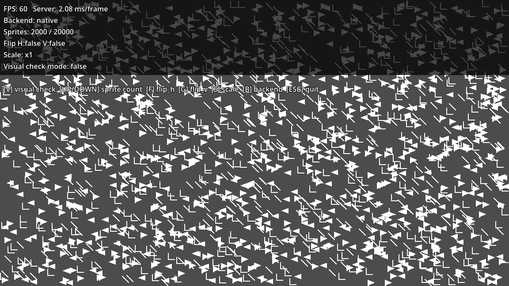
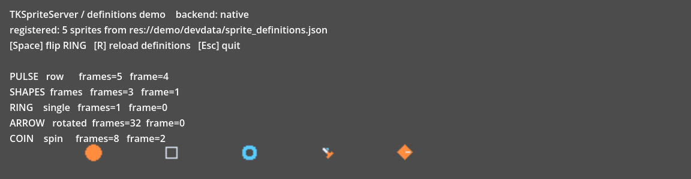

# TKSpriteServer

<p align="center">
  
</p>

English: see [README.md](README.md).

Godot 4 用の高スループット 2D スプライトサーバーです。
GDExtension (C++) 実装と、API 互換の純 GDScript 実装を同梱し、
実行時に自動で切り替えます（ネイティブライブラリが無い環境でもそのまま動作します）。

- リンクID方式のスプライトプール（数万枚規模）
- dirty フラグによる差分更新（変化のないスプライトは再描画しません）
- 5 プレーンの描画管理（back / medium / front / effect / text）
- 反転（FLIP / FLOP）と拡縮の実行時切り替え
- スプライト文字 HUD（`sprlocate` / `sprprint` / `sprcls`）
- JSON スプライト定義システムと、エディタ下部パネルの視覚的定義エディタ
- 回転アトラス・スピンアトラスの自動生成（1 枚の絵から最大 256 方向）
- Aseprite 連携（エクスポート JSON の取り込み。再インポートしても sprite_id は変わりません）

## 性能

`demo/demo_stress.tscn` での実測（`_update_sprites` + `commit_frame` の 60 フレーム平均、
Windows / Godot 4.6.3。GPU 負荷や vsync 待ちは含みません）。

| スプライト数 | GDExtension | GDScript フォールバック |
|---|---|---|
| 10,000 | **7.2 – 8.5 ms/frame** | 82 – 87 ms/frame |
| 20,000 | **15.0 – 16.6 ms/frame** | 61 – 167 ms/frame |

ネイティブ実装は体数に対してほぼ線形で、フレーム時間も安定しています。

## 動作環境

- Godot 4.4 以降（`compatibility_minimum = 4.4`）
- 同梱バイナリ: Windows x86_64（template_debug / template_release）
- 同梱バイナリが無いプラットフォームでは、GDScript 実装へ自動的にフォールバックします。
  API と描画結果は両バックエンドで同一です。

## 導入

1. `addons/tk_sprite_server/` をプロジェクトの `addons/` へコピーします。
2. プロジェクト設定 → プラグイン で **TKSpriteServer** を有効化します。
   エディタ下部に「Sprite Definitions」パネルが追加されます。
3. GDExtension を認識させるため、エディタを一度再起動してください。

## 最小の使い方

```gdscript
extends Node2D

var _server: Object
var _link_id: int

func _ready() -> void:
	# 描画先の canvas_item を 3 枚用意します。
	var back: RID = RenderingServer.canvas_item_create()
	var medium: RID = RenderingServer.canvas_item_create()
	var front: RID = RenderingServer.canvas_item_create()
	for plane_rid in [back, medium, front]:
		RenderingServer.canvas_item_set_parent(plane_rid, get_canvas())

	# ネイティブが使えれば native、無ければ gdscript のサーバーが返ります。
	# 戻り値は Node なので、必ずシーンツリーへ入れてください。
	_server = TKSpriteServer.create(4096, true)
	add_child(_server)
	_server.set_plane_rids(back, medium, front)
	print(TKSpriteServer.get_backend_name(_server))  # "native" / "gdscript"

	# 定義 JSON のスプライトをまとめて登録します。
	TKSpriteRegistry.register_all(_server, "res://devdata/sprite_definitions.json")

	# sprite_id 0 のスプライトを 1 体確保します。
	_link_id = _server.allocate_link_id(0)

func _process(_delta: float) -> void:
	_server.update_sprite(_link_id, Vector2(120.0, 80.0), 0)
	# 1 フレームの最後に 1 回だけ呼びます。ここで実際の描画が確定します。
	_server.commit_frame()
```

## ドキュメント

| 文書 | 内容 |
|---|---|
| [使い方ガイド](docs/guide.ja.md) / [User guide](docs/guide.md) | まずはこちら。空のプロジェクトから大量スプライトまでと、つまずいたときの対処 |
| [API リファレンス](docs/api.ja.md) | 公開クラスとメソッドの一覧 |
| [スプライト定義ファイル](docs/sprite_definitions.ja.md) | JSON スキーマ、レイアウト、v1 互換 |
| [Aseprite 連携](docs/aseprite.ja.md) | 書き出し、取り込み、再インポート時に残るもの |

## 主な API

| 呼び出し | 内容 |
|---|---|
| `TKSpriteServer.create(max_sprites, pixel_snap, prefer_native)` | バックエンドを自動選択してサーバーを生成します |
| `TKSpriteServer.get_backend_name(server)` | `"native"` / `"gdscript"` を返します |
| `server.set_plane_rids(back, medium, front)` | 描画先プレーンを設定します |
| `server.allocate_link_id(sprite_id, flip_h, flip_v, plane_type, priority)` | 永続スプライトを確保します |
| `server.update_sprite(link_id, pos, frame, color, plane_type, priority)` | 位置・フレーム・色を更新します |
| `server.update_sprite_scaled(link_id, pos, scale, ...)` | 倍率指定で拡縮します |
| `server.update_sprite_stretched(link_id, pos, draw_size, ...)` | 描画サイズ指定で拡縮します |
| `server.set_sprite_flip(link_id, flip_h, flip_v)` | 実行中に反転を切り替えます |
| `server.request_draw(sprite_id, pos, flip_h, flip_v, plane_type, priority)` | その 1 フレームだけの使い捨て描画です |
| `server.destroy_sprite(link_id)` | スプライトを解放します |
| `server.commit_frame()` | フレーム末尾に 1 回呼びます |
| `TKSpriteRegistry.register_all(server, defs_path, draw_size_scale)` | 定義 JSON を一括登録します |
| `TKAsepriteImporter.import_sheet_into_file(...)` | Aseprite のエクスポート JSON を定義ファイルへ取り込みます |

## デモ

`demo/demo_stress.tscn` — スループット計測用。実行中に反転と拡縮を切り替えられます。

<p align="center">
  
</p>

`demo/demo_definitions.tscn` — 5 種のレイアウト（row / frames / single / rotated / spin）を
1 つの JSON から再生します。rotated と spin のアトラスは 1 枚の元絵から実行時に生成されます。

<p align="center">
  
</p>

## フォルダ構成

| パス | 内容 |
|---|---|
| `addons/tk_sprite_server/` | 配布するアドオン本体（バイナリ同梱） |
| `native/` | GDExtension の C++ ソースとビルド設定（`.gdignore` 済み・エクスポート対象外） |
| `demo/` | `demo_stress`（性能計測）と `demo_definitions`（定義 JSON 再生）のデモシーン |
| `tests/` | ヘッドレスで実行できるテストスイート |
| `docs/` | 使い方ガイドとリファレンス |
| `tools/` | リポジトリ整備用スクリプト（アイコン・スクリーンショット生成） |

デモとテストのアセットはすべて実行時生成のプレースホルダ図形で、ゲームアートは含みません。

## 現在の状態

コア実装、Windows ビルド、定義システム、定義エディタ、Aseprite エクスポート JSON の
取り込みまで完了しています。`.aseprite` バイナリの直接読み込みは今後の予定です。

## ライセンス

MIT License / Copyright (c) 2026 Ken TSUISHI
