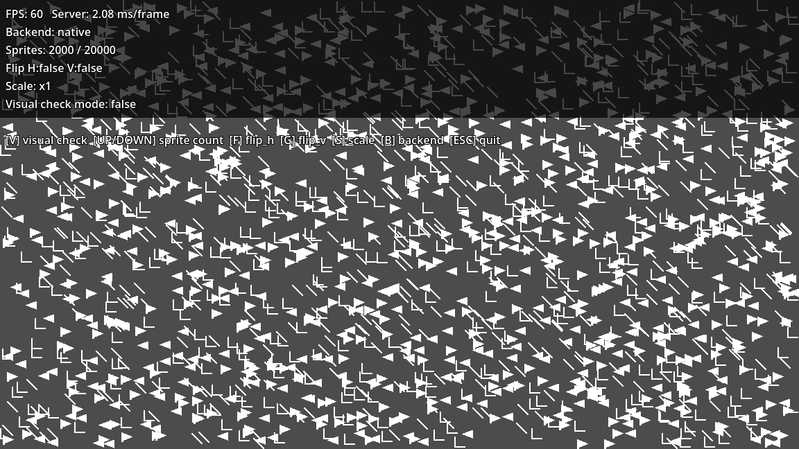
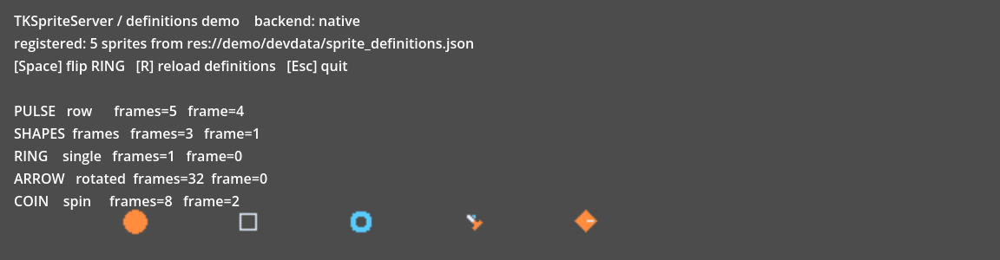

# TKSpriteServer

<p align="center">
  
</p>

A high-throughput 2D sprite server for Godot 4.

It ships a GDExtension (C++) backend together with an API-compatible pure GDScript
backend, and picks one automatically at runtime — so your project still runs on
platforms where no native binary is available.

日本語版は [README.ja.md](README.ja.md) を参照してください。

- Link-ID sprite pool that scales to tens of thousands of sprites
- Dirty-flag incremental updates — unchanged sprites are never redrawn
- Five draw planes (back / medium / front / effect / text)
- Runtime flip (FLIP / FLOP) and scaling
- Sprite-text HUD (`sprlocate` / `sprprint` / `sprcls`)
- JSON sprite definition system with a visual definition editor in a bottom panel
- Automatic rotation and spin atlas generation (up to 256 directions from one source image)
- Aseprite integration (imports exported JSON; sprite ids stay stable across re-imports)

## Performance

Measured with `demo/demo_stress.tscn` — 60-frame average of `_update_sprites` +
`commit_frame`, on Windows / Godot 4.6.3. GPU load and vsync waits are excluded.

| Sprites | GDExtension | GDScript fallback |
|---|---|---|
| 10,000 | **7.2 – 8.5 ms/frame** | 82 – 87 ms/frame |
| 20,000 | **15.0 – 16.6 ms/frame** | 61 – 167 ms/frame |

The native backend scales close to linearly with sprite count and keeps frame time stable.

## Requirements

- Godot 4.4 or newer (`compatibility_minimum = 4.4`)
- Bundled binaries: Windows x86_64 (template_debug / template_release)
- On platforms without a bundled binary the GDScript backend takes over automatically.
  The API and the rendered result are identical on both backends.

## Installation

1. Copy `addons/tk_sprite_server/` into your project's `addons/` directory.
2. Enable **TKSpriteServer** in Project Settings → Plugins.
   A "Sprite Definitions" panel is added to the editor's bottom dock.
3. Restart the editor once so the GDExtension is picked up.

## Quick start

```gdscript
extends Node2D

var _server: Object
var _link_id: int

func _ready() -> void:
    # Create the three canvas items the server draws into.
    var back: RID = RenderingServer.canvas_item_create()
    var medium: RID = RenderingServer.canvas_item_create()
    var front: RID = RenderingServer.canvas_item_create()
    for plane_rid in [back, medium, front]:
        RenderingServer.canvas_item_set_parent(plane_rid, get_canvas())

    # Returns the native server when available, the GDScript one otherwise.
    # The result is a Node, so it must be added to the scene tree.
    _server = TKSpriteServer.create(4096, true)
    add_child(_server)
    _server.set_plane_rids(back, medium, front)
    print(TKSpriteServer.get_backend_name(_server))  # "native" / "gdscript"

    # Register every sprite described by a definition file.
    TKSpriteRegistry.register_all(_server, "res://devdata/sprite_definitions.json")

    # Reserve one persistent sprite using sprite_id 0.
    _link_id = _server.allocate_link_id(0)

func _process(_delta: float) -> void:
    _server.update_sprite(_link_id, Vector2(120.0, 80.0), 0)
    # Call once at the end of the frame. This is where drawing is committed.
    _server.commit_frame()
```

## API overview

| Call | Purpose |
|---|---|
| `TKSpriteServer.create(max_sprites, pixel_snap, prefer_native)` | Create a server with the backend chosen automatically |
| `TKSpriteServer.get_backend_name(server)` | Returns `"native"` or `"gdscript"` |
| `server.set_plane_rids(back, medium, front)` | Set the canvas items to draw into |
| `server.allocate_link_id(sprite_id, flip_h, flip_v, plane_type, priority)` | Reserve a persistent sprite |
| `server.update_sprite(link_id, pos, frame, color, plane_type, priority)` | Update position, frame and colour |
| `server.update_sprite_scaled(link_id, pos, scale, ...)` | Scale by a factor |
| `server.update_sprite_stretched(link_id, pos, draw_size, ...)` | Scale to an explicit draw size |
| `server.set_sprite_flip(link_id, flip_h, flip_v)` | Flip at runtime |
| `server.request_draw(sprite_id, pos, flip_h, flip_v, plane_type, priority)` | One-shot draw for a single frame |
| `server.destroy_sprite(link_id)` | Release a sprite |
| `server.commit_frame()` | Call once per frame, at the end |
| `TKSpriteRegistry.register_all(server, defs_path, draw_size_scale)` | Register a whole definition file |
| `TKAsepriteImporter.import_sheet_into_file(...)` | Merge an Aseprite export into a definition file |

## Demos

`demo/demo_stress.tscn` — throughput benchmark, with runtime flip and scale toggles.

<p align="center">
  
</p>

`demo/demo_definitions.tscn` — the five definition layouts (row / frames / single /
rotated / spin) played back from a single JSON file. The rotated and spin atlases are
generated at run time from one source image.

<p align="center">
  
</p>

## Repository layout

| Path | Contents |
|---|---|
| `addons/tk_sprite_server/` | The add-on itself, binaries included |
| `native/` | GDExtension C++ sources and build files (`.gdignore`d, excluded from exports) |
| `demo/` | `demo_stress` (benchmark) and `demo_definitions` (definition playback) scenes |
| `tests/` | Headless test suites |
| `tools/` | Repository maintenance scripts (icon generation) |

All demo and test assets are placeholder shapes generated at build time; no game art is included.

## Status

The core, the Windows build, the definition system, the definition editor and the
Aseprite JSON import are complete. Reading `.aseprite` files directly is planned.

## License

MIT License / Copyright (c) 2026 Ken TSUISHI
